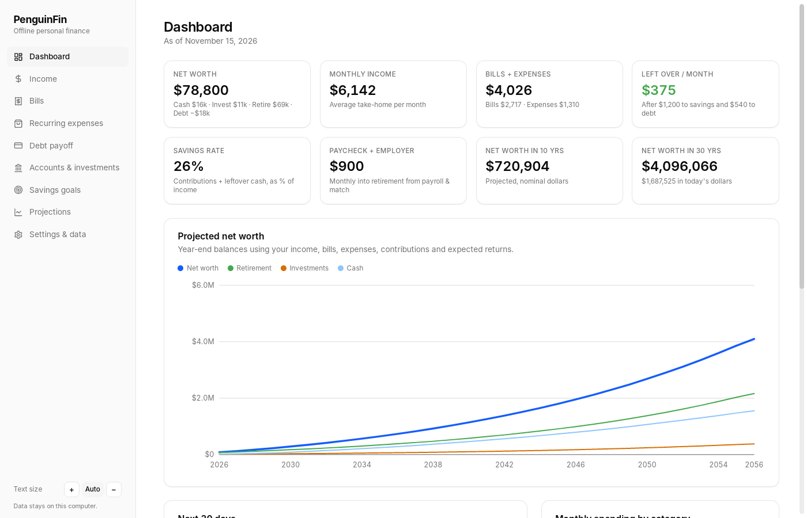
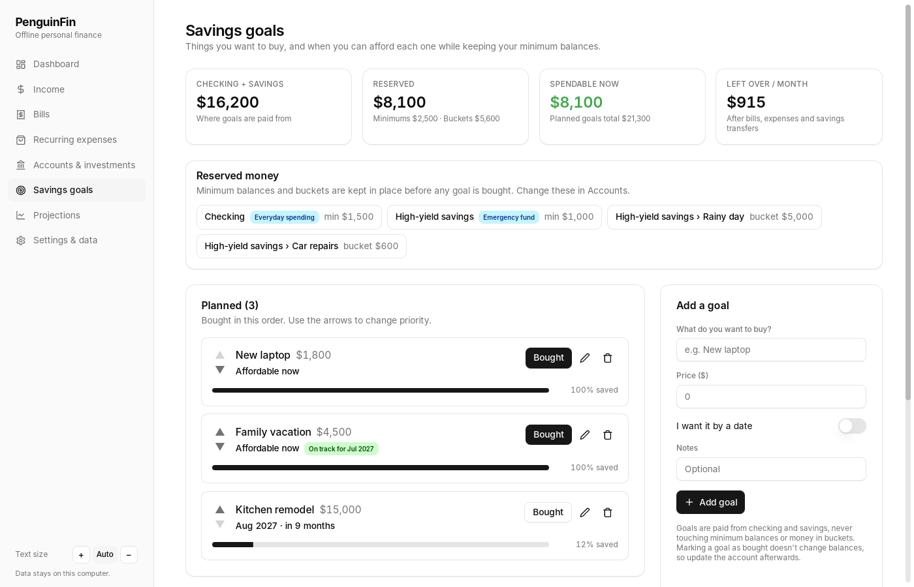
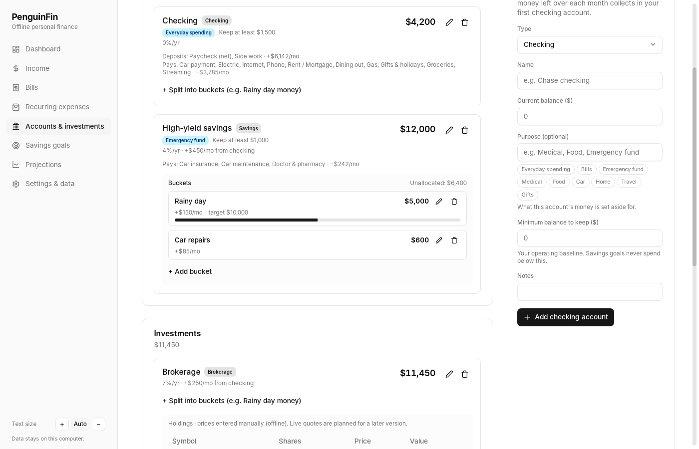
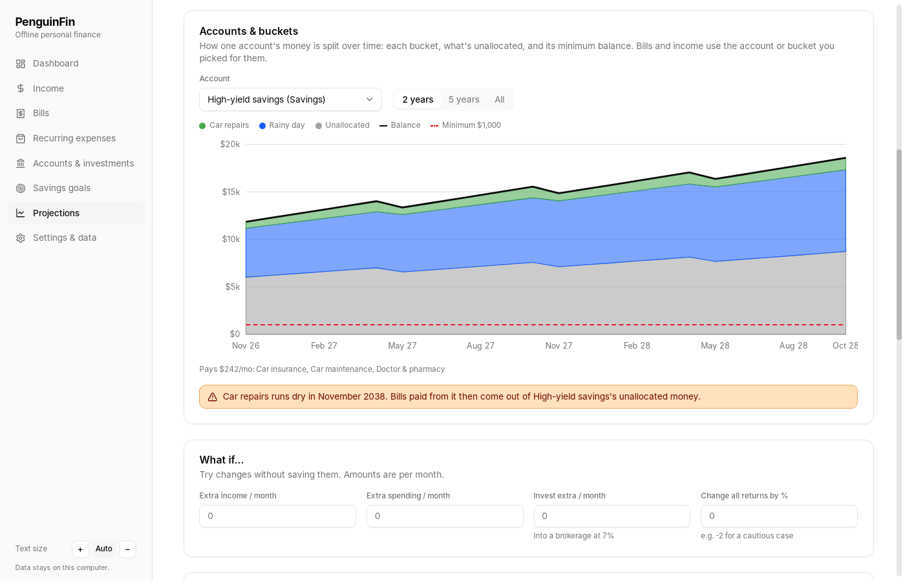
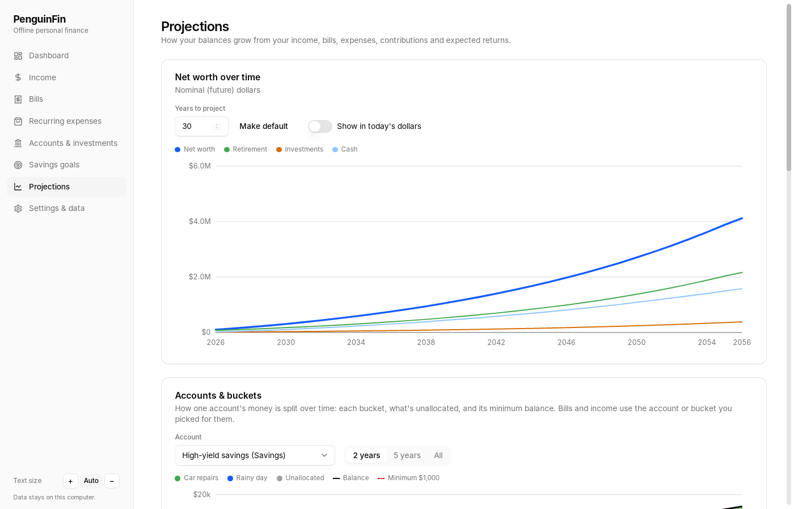
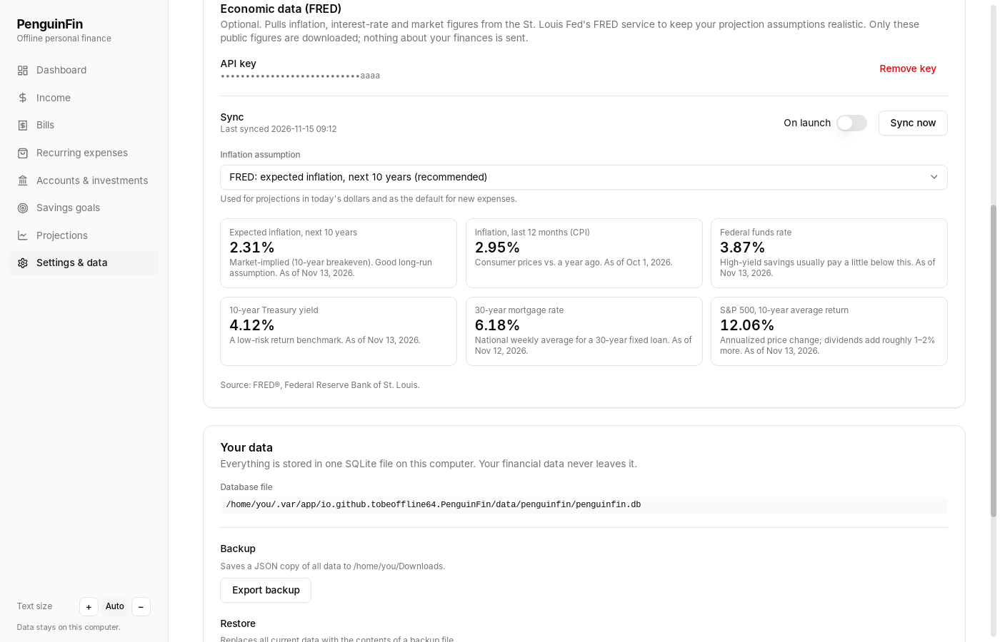
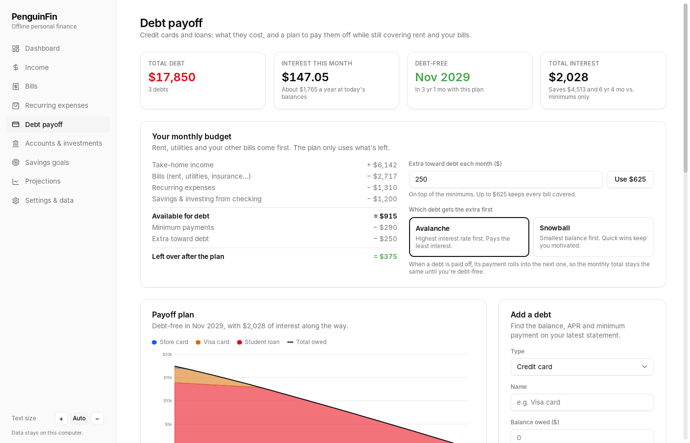
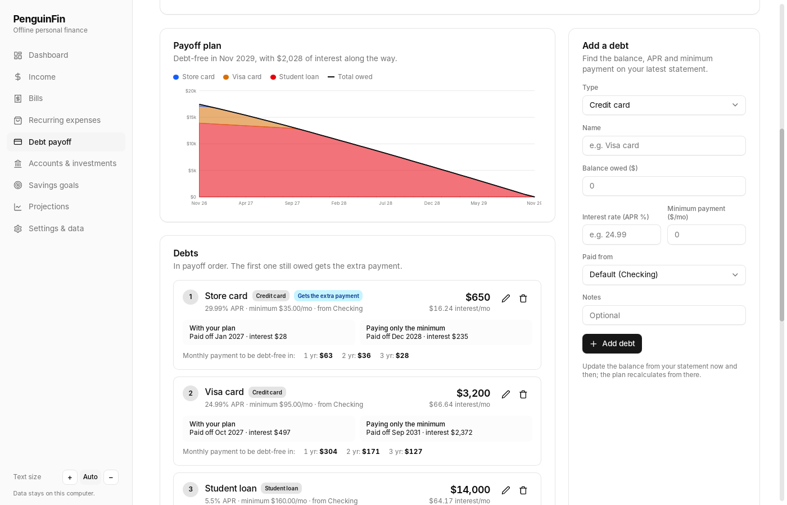
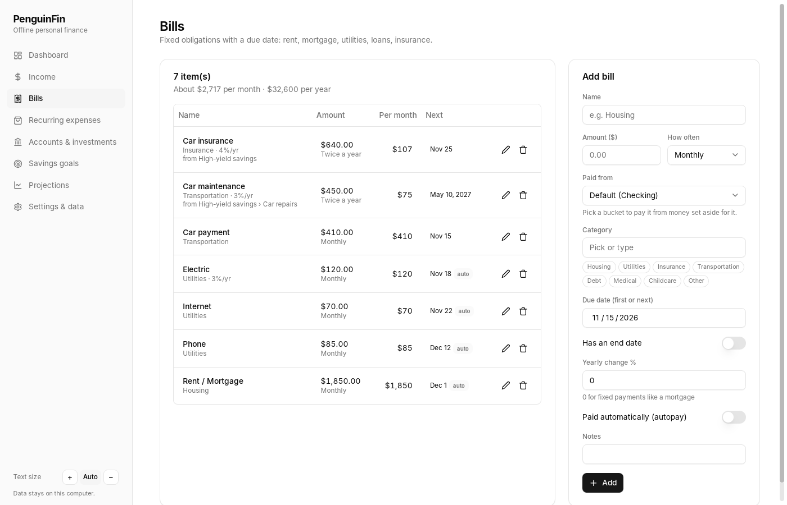
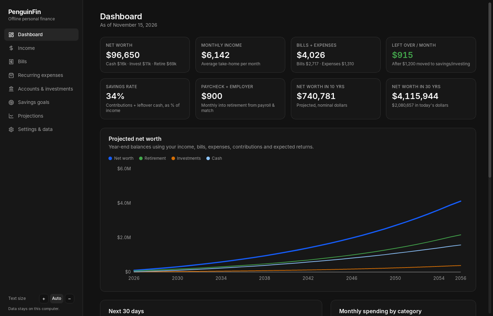

# PenguinFin

Offline personal finance planner for **Linux and Windows** (macOS, iPhone and Android are planned).
Track income, bills and recurring expenses, add your checking/savings/brokerage/retirement accounts,
split them into buckets, pay down debt, plan purchases with savings goals, and see month-by-month
projections of where your money goes over the next decades.

**[Download](https://github.com/tobeoffline64/PenguinFin/releases)** ·
**[Wiki & user guide](https://github.com/tobeoffline64/PenguinFin/wiki)**

**PenguinFin 2** is built in **Rust** with **[Tauri 2](https://tauri.app)** and a
**[Leptos](https://leptos.dev)** interface compiled to WebAssembly, using components from
**[Rust/UI](https://github.com/rust-ui/ui)** (Tailwind CSS v4). Data is stored in a single local
**SQLite** file. The app makes no network requests unless you turn on the optional FRED economic data.

> 2.0 is in beta ([2.0.0-beta.1](https://github.com/tobeoffline64/PenguinFin/releases/tag/v2.0.0-beta.1)).
> PenguinFin 1.x (Dioxus) is archived on the [`archive/v1`](https://github.com/tobeoffline64/PenguinFin/tree/archive/v1)
> branch; 1.10.0 stays the "latest" release until 2.0.0 is final. Installing 2.0 upgrades 1.x data in
> place after saving a copy of it.

## Screenshots

| | |
|---|---|
|  |  |
| **Dashboard**: net worth, cash flow, next 30 days, projection | **Savings goals**: when you can afford each purchase while keeping your reserves |
|  |  |
| **Accounts**: purposes, minimum balances, buckets, holdings | **Accounts & buckets chart**: an account split by bucket over time |
|  |  |
| **Projections**: net worth over decades, what-if scenarios | **Economic data**: optional live inflation and rates from FRED |
|  |  |
| **Debt payoff**: budget after rent and bills, avalanche or snowball | **Payoff plan**: balances over time, per-debt payoff, schedule |
|  |  |
| **Bills, income & expenses** with where each is paid from | **Dark mode** |

## Features

- **Income, Bills, Recurring expenses**: weekly, every 2 weeks, twice a month, monthly, quarterly,
  twice a year, yearly or one-time; start/due date, optional end date (for example when a car loan ends),
  yearly raise or price change, and autopay or direct-deposit flag.
- **Dashboard**: net worth, monthly income vs. outflow, leftover cash, savings rate, projected net worth,
  the next 30 days of payments, and spending by category.
- **Accounts & investments**: checking, savings, brokerage, 401(k)/403(b), Traditional/Roth IRA, HSA,
  pension, other. Each account has an expected return/APY, a monthly contribution (from checking or via
  payroll), employer match, and optional **holdings** (symbol × shares × price).
- **Debt payoff**: credit cards and loans with balance, APR and minimum payment. Shows interest per month,
  minimum-only payoff, and payments needed to be debt-free in 1–3 years. A payoff plan (avalanche or snowball,
  with rollover) uses only what's left after rent, bills and expenses, with a chart and a monthly schedule.
  Debt counts against net worth and is paid in projections. Log one-time payments (bonus, tax refund) or
  schedule future ones; the plan and projections include them, and a payment history lets you undo any.
- **Savings goals**: things to buy with a price, optional "want it by" date and priority. Shows when each becomes
  affordable from checking + savings while keeping every account's minimum balance, even through later bills in the
  projection; how much more to save per month to hit a date; and spendable cash over time after the purchases.
- **Account purposes & minimum balances**: tag accounts (Medical, Food, Emergency fund…) and set an operating
  baseline; accounts below it are flagged and goals never spend it.
- **Buckets & money routing**: split accounts into buckets (e.g. Rainy day money) with monthly top-ups and
  targets; choose which account or bucket pays each bill/expense and where income is deposited. Projections
  simulate every account and bucket, and the *Accounts & buckets* chart stacks an account's buckets and
  unallocated money over time with its minimum balance and run-dry warnings.
- **Projections**: 1–80 years, nominal or inflation-adjusted ("today's dollars"), milestone cards,
  a year-by-year table, a warning when cash would run short, and **what-if** scenarios (extra income,
  extra spending, extra investing, lower/higher returns) that are not saved.
- **Settings & data**: currency symbol, inflation, dark mode, JSON backup and checked `.pfexport` copies saved
  where you choose, restore from a backup, export or another computer's database (with a preview first),
  sample data, erase all. The FRED key is kept in the system keychain and never put in a backup.
- **Interface**: text size *Auto* (scales with the window) or bigger/smaller from the sidebar or
  Ctrl + / Ctrl − / Ctrl 0. The layout reflows to the space it has. Charts read out values on hover
  or drag. Calculations run in the window, so pages update instantly.
- **Economic data (FRED, optional)**: with a free API key, pulls expected and current inflation, the fed
  funds rate, 10-year Treasury, 30-year mortgage rate and the S&P 500's 10-year return. Syncs in the background
  on launch and on demand (Settings → Economic data); inflation can follow FRED automatically; account forms and
  Projections show the figures as guidance. Without a key the app makes no network requests.

### How projections work
Each month: every account grows by its own expected return, then receives its contribution and match.
Income minus bills, expenses and contributions "from checking" lands in your first checking account.
Each cash-flow amount changes by its own yearly % once per elapsed year. Paydays and due dates are
counted exactly, so a biweekly paycheck lands three times in some months.

### Stock prices
Prices are typed in by hand. `crates/penguinfin-core/src/prices.rs` defines a `PriceProvider` trait, so a live quote
API can be added later without touching storage or the UI.

## Design system

Building a new screen or feature? Start with [docs/design-system](docs/design-system/README.md): tokens, component guidelines with previews, page patterns, the plan for iPhone and Android, and a [feature tree](docs/design-system/feature-tree.html) of everything the app does.

## Install on Windows

From the [releases page](https://github.com/tobeoffline64/PenguinFin/releases), download either
`PenguinFin-<version>-windows-x64-setup.exe` (installer, with a Start menu entry and uninstaller) or
`PenguinFin-<version>-windows-x64-portable.zip` (extract and run **PenguinFin.exe**). Windows may say
*"Windows protected your PC"* because the app isn't code-signed: click **More info → Run anyway**. It
needs the Microsoft Edge WebView2 Runtime, which Windows 11 and up-to-date Windows 10 already have.
Data is stored in `%APPDATA%\PenguinFin\penguinfin.db` and the FRED key in Credential Manager.

## Install the flatpak (Linux)

Download the `.flatpak` file from the [releases page](https://github.com/tobeoffline64/PenguinFin/releases)
(`penguinfin-2.flatpak` for 2.0.0-beta.1, `penguinfin.flatpak` from then on), then, in that folder:

```bash
flatpak remote-add --user --if-not-exists flathub https://dl.flathub.org/repo/flathub.flatpakrepo
flatpak install --user -y --reinstall penguinfin-2.flatpak
flatpak run io.github.tobeoffline64.PenguinFin
```

The first install also pulls the GNOME 49 runtime from Flathub. Installing over 1.x keeps your data:
PenguinFin saves `penguinfin-1.x-backup-<date>.db` next to the database, then upgrades it. The release
notes explain how to go back to 1.x.

The flatpak's `network` permission is only for the optional FRED data, and it can talk to the
desktop keychain (Secret Service) to keep the FRED key. Your database is at
`~/.var/app/io.github.tobeoffline64.PenguinFin/data/penguinfin/penguinfin.db`.

## Releasing

`.github/workflows/release.yml` publishes a release whenever the `version` in `Cargo.toml` has no
release yet: the flatpak, the Windows installer and portable zip, and the source archive. A version
with a suffix (`2.0.0-beta.1`) is published as a pre-release. Bump `version` in `Cargo.toml`, add a
`<release>` to `flatpak/*.metainfo.xml`, update `.github/release-notes.md`, and push to `main`.
`ci.yml` runs tests and clippy (including the WebAssembly interface) and a Windows build on every
push; `wiki.yml` publishes `docs/wiki/` to the GitHub wiki.

## Build from source

```bash
sudo apt install libwebkit2gtk-4.1-dev libgtk-3-dev libsoup-3.0-dev libdbus-1-dev   # Ubuntu deps
rustup target add wasm32-unknown-unknown
cargo install --locked trunk
cargo install --locked tauri-cli --version '^2'
npm ci                                            # Tailwind CLI
npx @tailwindcss/cli -i style/app.css -o assets/app.css --minify
cd src-tauri && cargo tauri dev                   # live reload; `cargo tauri build` for a release build
cargo test --workspace
```

`PENGUINFIN_DB=/path/to/file.db` uses a different database, and `PENGUINFIN_NO_KEYCHAIN=1` keeps the
FRED key in a private file instead of the keychain. `PENGUINFIN_FRED_URL` points the FRED client at
another server; `cargo run -p penguinfin-core --example fred_check -- <key>` fetches every indicator from
the command line, and `cargo run -p penguinfin-store --example seed -- /path/to/file.db` fills a
database with sample data.

Build the flatpak bundle (needs `sudo apt install flatpak flatpak-builder`):

```bash
./build-flatpak.sh
```

It builds the interface, vendors the crates and runs `flatpak-builder` offline, producing
`dist/penguinfin.flatpak`. See [docs/ARCHITECTURE.md](docs/ARCHITECTURE.md) for how the backend,
interface and crates fit together.

## Layout

| Path | What |
| --- | --- |
| `crates/penguinfin-core/` | The finance engine, no storage or UI: `model.rs` (domain types, schedule math), `projection.rs` (monthly projections), `debt.rs` (payoff plans), `goals.rs` (savings-goal planner), `fred.rs` (FRED client, behind the `net` feature), `ipc.rs` (types shared by backend and interface), `prices.rs`, `sample.rs`, `format.rs` |
| `crates/penguinfin-store/` | Storage: `db.rs` (SQLite schema, migrations, CRUD, JSON backup), `export.rs` (`.pfexport` files and importing any backup, export or database file), `tests/fixtures/` (databases written by every 1.x schema) |
| `src-tauri/` | The backend: the only part that opens the database, files or the network. Every command is allow-listed in `build.rs` and `capabilities/default.json`; `src/secrets.rs` keeps the FRED key |
| `ui/` | The Leptos interface, built with Trunk: `src/app.rs` (shell and store), `src/pages/`, `src/ui/` (Rust/UI components, MIT), `src/charts.rs` |
| `style/app.css` | Tailwind source with Rust/UI theme tokens; compiled to `assets/app.css` |
| `flatpak/` | Manifest, desktop file, AppStream metadata, icon |
| `packaging/windows/` | README for the portable Windows zip |
| `docs/` | Architecture notes, design system, wiki pages, screenshots |
