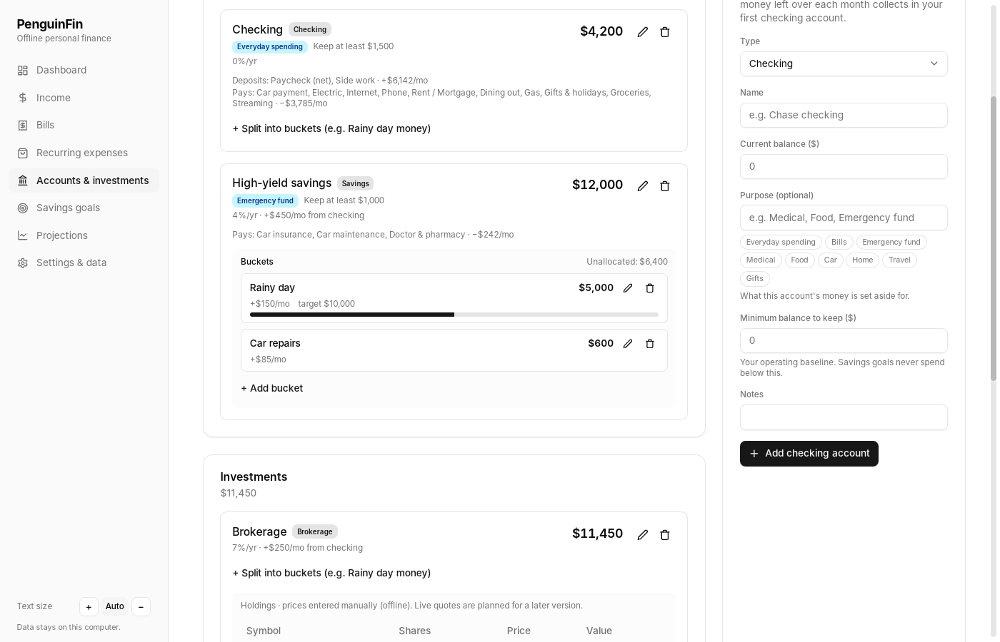

# Accounts & buckets

## Account types

The add/edit form changes with the selected type:

| Type | Asks for |
|---|---|
| Checking | Balance. Leftover money each month collects in your first checking account. |
| Savings | Balance, interest rate (APY), monthly transfer from checking. |
| Brokerage | Cash balance, expected return, monthly investment from checking, plus optional **holdings** (symbol × shares × price). |
| 401(k) / 403(b), Pension / TSP | Balance, expected return, paycheck contribution, employer match. |
| Traditional / Roth IRA, HSA | Balance, expected return, monthly contribution, and whether it's paid from checking or payroll. |
| Other asset | Current value and expected yearly change (negative for things that lose value, like a car). |

## Purpose and minimum balance

Every account can have a **purpose** (Everyday spending, Bills, Emergency fund, Medical, Food…) and a
**minimum balance to keep**, its operating baseline. Accounts below their minimum are flagged in red.
Savings goals never spend the minimum balance of checking or savings accounts.

## Buckets

Buckets split an account into named portions, such as *Rainy day money* or *Car repairs*:

- **Set aside now**: how much of the balance is in the bucket today.
- **Add each month**: moved into the bucket from the account's unallocated money every month.
- **Target**: monthly additions stop when the bucket reaches it.

The account card shows each bucket (with progress toward its target) and the **unallocated** remainder,
and warns if the buckets add up to more than the balance. Money in buckets is reserved: savings goals
won't spend it.

## Paying bills from an account or bucket

On any bill or expense, choose **Paid from**: an account, or a bucket inside one
(e.g. *High-yield savings › Car repairs*). Income has **Deposited to**. Each account card lists what it
pays and receives per month.

In projections, a bucket pays its bills while it has money. If it runs out, the rest is paid from the
account's unallocated money and you get a warning. See the chart on [Projections](Projections).
