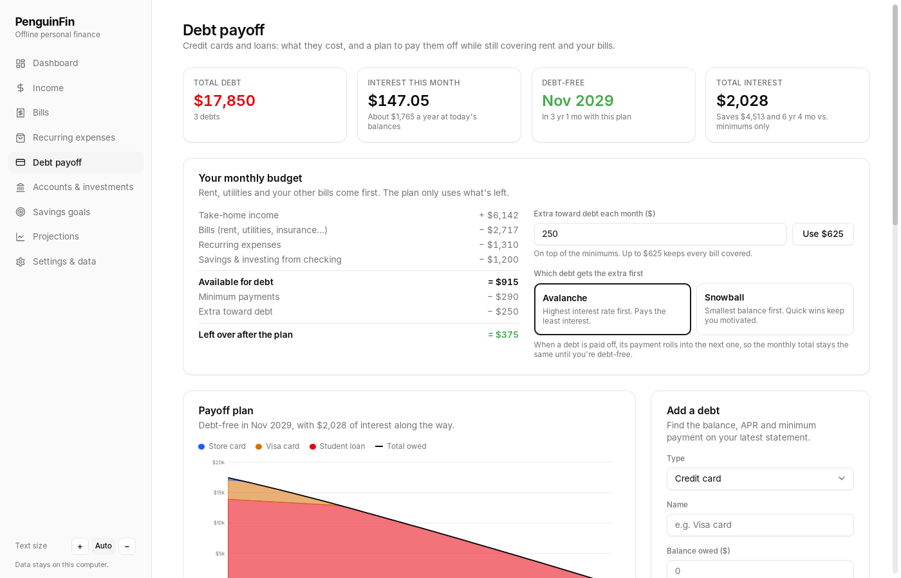
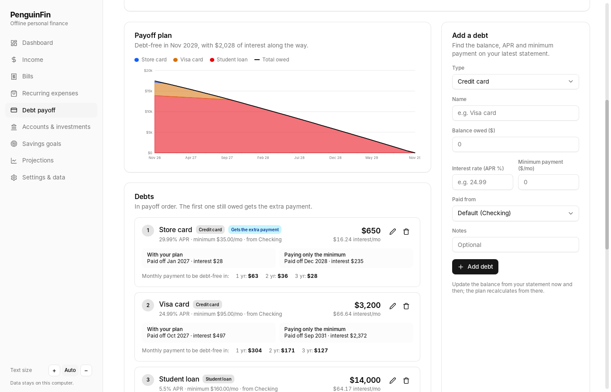

# Debt payoff

Add credit cards and loans to see what they cost each month and get a plan to pay them off **while
still covering rent, utilities and your other bills**.

## Adding a debt

From your latest statement: **balance**, **interest rate (APR)** and **minimum payment**, plus the
account the payments come from (default: your first checking account). Types: credit card, personal
loan, student loan, auto loan, medical bill, other.

While you type, the form shows the interest charged this month and how long paying only the minimum
would take. A warning appears if the minimum doesn't even cover the interest.

## Your monthly budget

The budget card starts from your take-home income and subtracts bills (rent, utilities, insurance…),
recurring expenses and savings transfers. What's left is **available for debt**. The plan then takes the
minimum payments and the **extra** you choose, and shows what's left over. You're warned if:

- the minimums alone are more than what's left after bills, or
- the plan needs more than you have. It tells you the most you can add without missing a bill.

**Use $…** sets the extra to everything that's left.

## Strategy

- **Avalanche**: extra money goes to the highest interest rate first. Pays the least interest.
- **Snowball**: extra money goes to the smallest balance first. Quick wins.

When a debt is paid off, its payment rolls into the next one, so your monthly debt payment stays the
same until everything is paid.

## The plan

- **Debt-free date**, total interest, and how much you save compared with paying only minimums.
- A **chart** of each balance shrinking over time.
- Each debt, in payoff order: payoff date and interest with your plan vs. minimums only, and the monthly
  payment needed to be debt-free in 1, 2 or 3 years (standard loan amortization).
- A month-by-month **payment schedule** (✓ marks the month a debt is paid off).

## Everywhere else

- **Net worth** subtracts what you owe (dashboard, accounts, projections).
- **Projections** pay debts from their accounts each month according to your plan, and show a Debt line
  and column. Savings goals and cash forecasts include the payments.
- The dashboard's **Left over / month** is after your debt plan.

Interest is calculated monthly (APR ÷ 12). Update balances from your statements now and then; the plan
recalculates from there.
