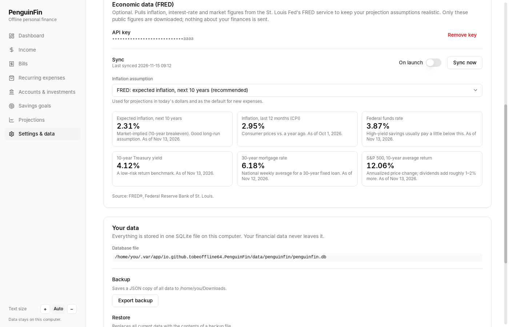

# Economic data (FRED)

PenguinFin can optionally download public economic figures from the St. Louis Fed's
[FRED](https://fred.stlouisfed.org/) service to keep your assumptions realistic. Nothing about your
finances is ever sent.

| Figure | FRED series | Used for |
|---|---|---|
| Expected inflation, next 10 years | T10YIE | Recommended inflation assumption |
| Inflation, last 12 months | CPIAUCSL (% change from a year ago) | Alternative inflation assumption |
| Federal funds rate | DFF | Guidance for savings APY |
| 10-year Treasury yield | DGS10 | Low-risk return benchmark |
| 30-year mortgage rate | MORTGAGE30US | Context |
| S&P 500, 10-year average return | SP500 | Guidance for investment returns (price only; dividends add ~1–2%) |

## Setup

1. Get a free API key at <https://fredaccount.stlouisfed.org/apikeys> (create an account, then
   *Request API Key*).
2. In **Settings → Economic data (FRED)**, paste the key and click **Save & sync**.
3. Optionally set **Inflation assumption** to follow FRED.

## When it syncs

- Once each time PenguinFin starts, in the background after the window appears (turn off with
  **On launch**), and whenever you click **Sync now**.
- The last values are saved locally, so they show instantly and work offline.
- Without a key, PenguinFin makes no network requests.

Your API key is stored only on your computer and is never included in backups.
