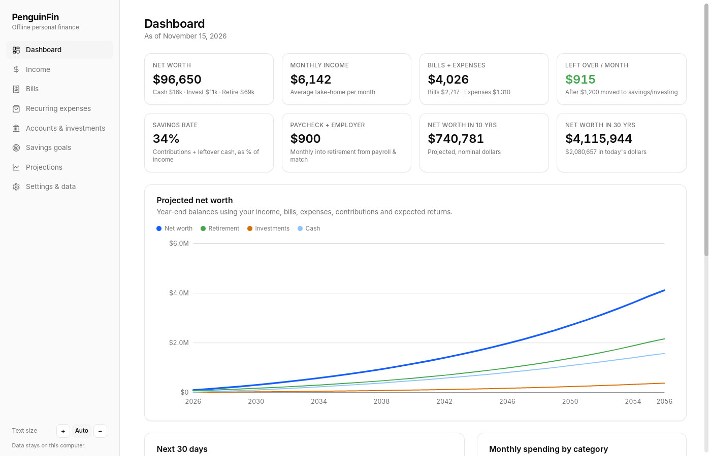

# Getting started

When PenguinFin starts for the first time the dashboard is empty. You can:

- **Load sample data** to look around with an example household (erase it later in
  *Settings → Erase all data*), or
- start entering your own numbers, in this order:

1. **Accounts & investments**: add your checking account first (leftover money collects there in
   projections), then savings, brokerage and retirement accounts. See [Accounts & buckets](Accounts-and-Buckets).
2. **Income**: your take-home pay (after tax and payroll deductions) and other income.
3. **Bills**: rent or mortgage, utilities, insurance, loans.
4. **Recurring expenses**: groceries, gas, subscriptions, dining out.
5. Optionally, **Savings goals** for things you want to buy, and buckets such as *Rainy day money*.

The **Dashboard** then shows your net worth, monthly cash flow, savings rate, the next 30 days of
payments and a projection of your net worth.

## Navigation tips

- The sidebar collapses to icons when the window is narrow or the text is large.
- **Text size**: the + / Auto / − control at the bottom of the sidebar, or **Ctrl +**, **Ctrl −** and
  **Ctrl 0** (back to Auto, which scales with the window).
- Every page opens scrolled to the top.
