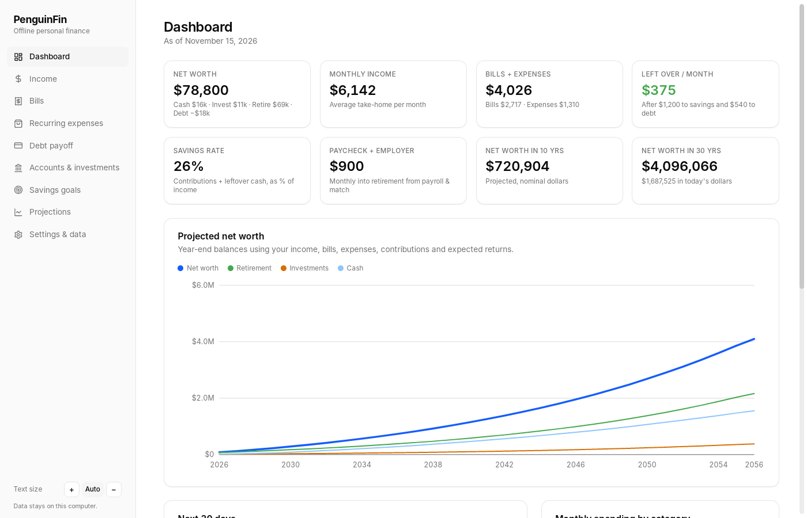

# PenguinFin

**PenguinFin** is an offline personal finance planner for Linux and Windows. Track your income, bills
and recurring expenses, organise your accounts into buckets, plan purchases with savings goals, and see
month-by-month projections of where your money is heading. Everything is stored in one file on your
computer.

## Pages

| | |
|---|---|
| [Installation](Installation) | Linux (flatpak) and Windows, updating |
| [Getting started](Getting-Started) | First steps and the sample household |
| [Income, bills & expenses](Income-Bills-and-Expenses) | Schedules, end dates, raises, where money goes |
| [Debt payoff](Debt-Payoff) | Credit cards and loans, interest, and a payoff plan that still covers your bills |
| [Accounts & buckets](Accounts-and-Buckets) | Account types, minimum balances, buckets, holdings |
| [Savings goals](Savings-Goals) | When you can afford things without touching your reserves |
| [Projections](Projections) | Net worth over time, what-if scenarios, the accounts & buckets chart |
| [Economic data (FRED)](Economic-Data-FRED) | Optional live inflation and rate data |
| [Settings & backups](Settings-and-Backups) | Interface size, dark mode, backups, data location |
| [Building from source](Building-from-Source) | Developer setup and release process |
| [Troubleshooting](Troubleshooting) | Blank window, scrolling, Windows warnings |

## Highlights

- Works offline. The only optional network feature is FRED economic data, which needs your own API key.
- Projections simulate every account and bucket month by month, including raises, inflation and returns.
- Savings goals tell you **when** you can afford something while keeping your minimum balances and buckets.
- A debt payoff plan (avalanche or snowball) that only uses what's left after rent and bills.
- Light and dark themes, an interface that scales to the window, and keyboard shortcuts for text size.
