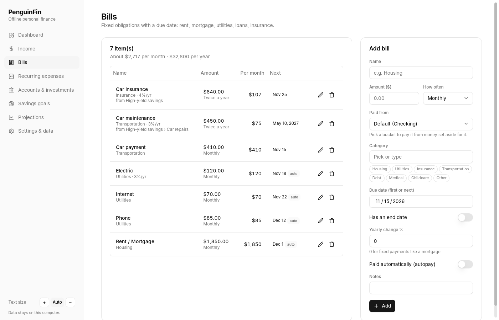

# Income, bills & expenses

PenguinFin has three lists that work the same way:

- **Income**: paychecks and other money coming in. Enter **take-home** pay (after tax and payroll
  deductions such as 401(k) contributions).
- **Bills**: fixed obligations with a due date: rent, mortgage, utilities, loans, insurance.
- **Recurring expenses**: spending that repeats: groceries, gas, subscriptions, dining out.

## Fields

| Field | Meaning |
|---|---|
| Amount / How often | Weekly, every 2 weeks, twice a month, monthly, quarterly, twice a year, yearly or one time. Paydays and due dates are counted exactly, so a biweekly paycheck lands three times in some months. |
| Due date / first pay date | The first (or next) occurrence; later ones follow the schedule. |
| Has an end date | For things that stop, like a car loan. |
| Yearly change % | Raises for income, price changes for bills and expenses (expenses default to your inflation setting). |
| **Paid from** / **Deposited to** | Which account (or bucket) the money comes out of or goes into. *Default* is your first checking account. See [Accounts & buckets](Accounts-and-Buckets). |
| Autopay / Direct deposit | A reminder label shown in lists and the next-30-days view. |

Each row shows its monthly equivalent, the next date, and where its money comes from or goes
("from High-yield savings › Car repairs").
