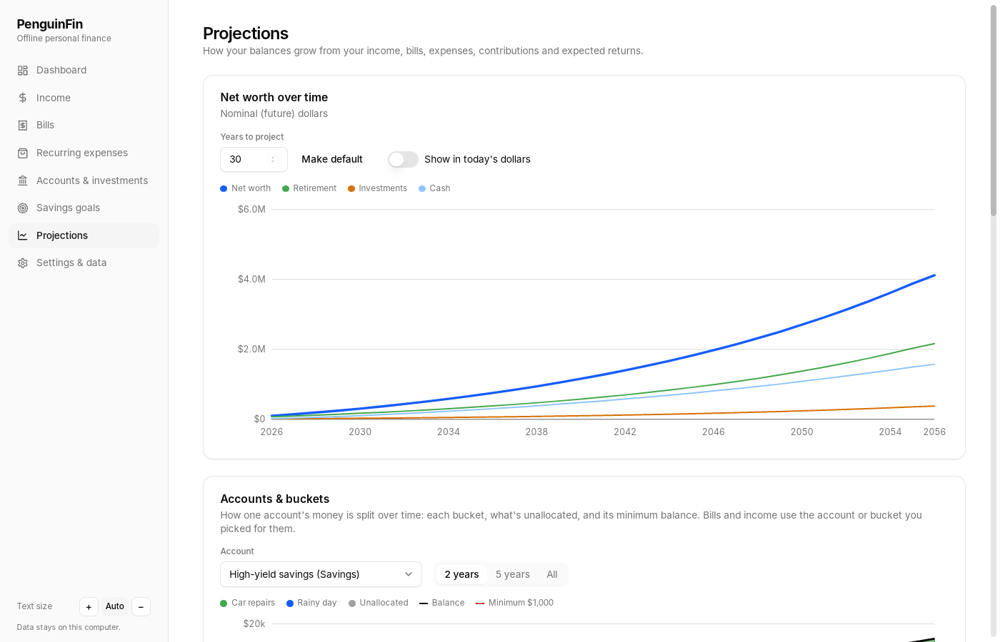
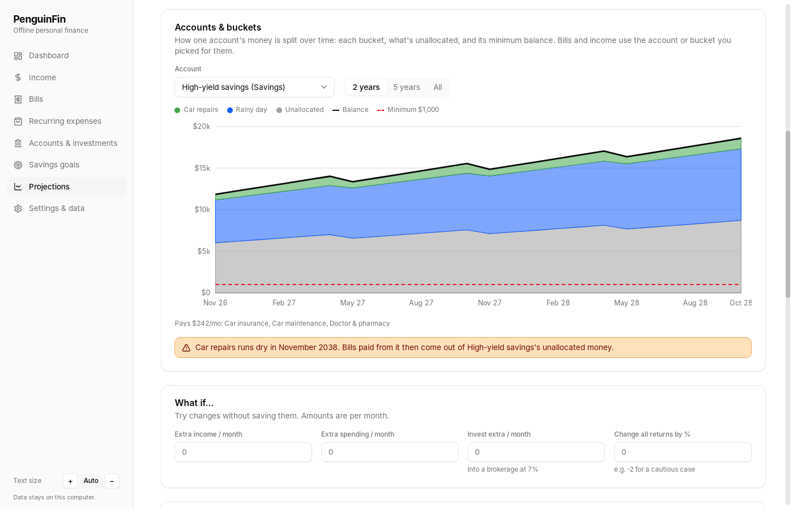

# Projections

The Projections page simulates your finances month by month for 1–80 years.

## Rules

- Every account grows by its own expected return (or APY), then receives its contributions and
  employer match.
- Income, bills and expenses go into or out of their own account or bucket (default: first checking).
- Amounts change by their own *yearly change %* once per year.
- Buckets top up toward their targets and pay the bills linked to them.

## On the page

- **Net worth over time**: retirement, investments and cash, in future dollars or **today's dollars**
  (adjusted for your inflation setting).
- **Accounts & buckets**: pick an account to see its balance stacked by bucket and unallocated money over
  2 years, 5 years or the whole projection, with its minimum balance as a dashed line. Warnings below the
  chart show when a bucket runs dry, when the account drops below its minimum, or when buckets add up to
  more than the balance.

- **What if…**: try extra income, extra spending, extra investing or different returns without saving
  anything.
- **Market context**: the latest FRED figures, if you use [Economic data](Economic-Data-FRED).
- **Milestones** and a **year-by-year table**.

Projections are estimates, not advice. They ignore taxes on withdrawals, market swings and fees unless
you include them in your return assumptions.
