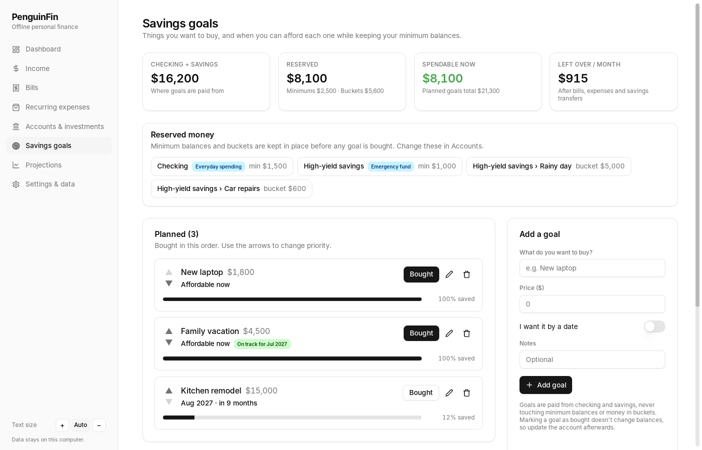

# Savings goals

List things you want to buy and PenguinFin tells you when you can afford each one.

## How it works

- Goals are paid from **checking and savings**.
- **Reserved** money is never counted as spendable: each account's minimum balance plus money in buckets.
- **Spendable** = checking + savings − reserved, projected month by month from your income, bills,
  expenses, transfers and interest.
- Goals are planned in **priority order** (use ▲ ▼). A goal is affordable in a month only if buying it,
  after the goals above it, keeps spendable money at or above zero **in that month and every later month**
  of the projection, so a big bill later on won't push you into your reserves.

Each goal shows:

- **When**: "Affordable now", or e.g. "Aug 2027 · in 9 months".
- **Progress**: how much of the price today's spendable money already covers (after higher-priority goals).
- **Want it by** (optional date): *On track*, or how much more to save per month to make it.

A chart shows spendable money over time with each purchase taken out. **Bought** moves a goal to the
Bought list (with Undo). It doesn't change account balances, so update the account afterwards.

The plan ignores the small amount of interest that spent money would have earned.
