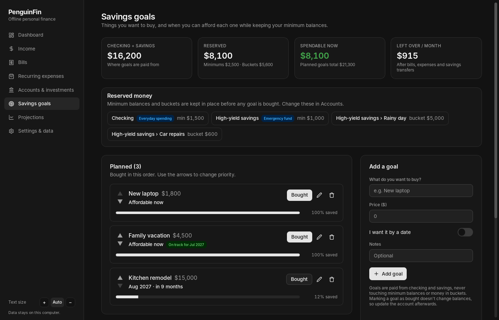

# Settings & backups

## Preferences & interface

- **Currency symbol**, **inflation %** (or follow FRED) and **default projection length**.
- **Dark mode**.
- **Interface size**: *Auto* scales everything to the window; or S / M / L / XL.
  Shortcuts: **Ctrl +**, **Ctrl −**, **Ctrl 0**.
- **Natural scrolling**: reverse wheel and touchpad direction (leave off if your system already does this).

## Your data

All data is in one SQLite file:

| System | Location |
|---|---|
| Linux (flatpak) | `~/.var/app/io.github.tobeoffline64.PenguinFin/data/penguinfin/penguinfin.db` |
| Windows | `%APPDATA%\PenguinFin\penguinfin.db` |

- **Export backup** saves a JSON copy to your Downloads folder.
- **Restore** replaces all data with a backup file (works across Linux and Windows).
- **Replace with sample data** / **Erase all data** for starting over.

Backups include accounts, holdings, buckets, bills, income, expenses, goals and preferences. They don't
include your FRED API key.
